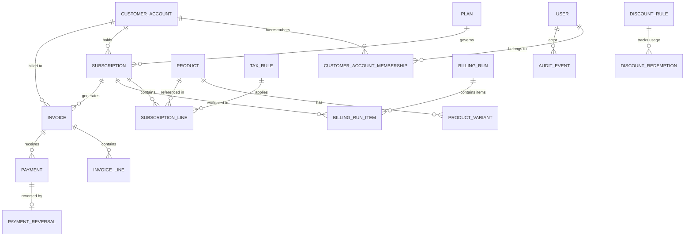

# Brightloop Subscription Management System — Architecture & Domain Specification

This document defines the architectural agreements, relational schema, security permissions, and operational invariants for Brightloop Software's Subscription Management System. All feature implementations across phases must align with these specifications.

---

## 1. Domain Data Model & Relational Schema

### Table Definitions & Constraints

#### 1. `users`

- `id`: UUID (Primary Key, default `gen_random_uuid()`)
- `email`: VARCHAR(255), Unique, Lowercased, Indexed
- `hashed_password`: VARCHAR(255), Not Null
- `full_name`: VARCHAR(255), Not Null
- `role`: VARCHAR(20), Not Null (`admin`, `staff`, `customer`)
- `is_active`: BOOLEAN, default `true`
- `created_at`: TIMESTAMPTZ, default `clock_timestamp()`
- `updated_at`: TIMESTAMPTZ, default `clock_timestamp()`

#### 2. `customer_accounts` & `customer_account_memberships`

- **`customer_accounts`**:
  - `id`: UUID (PK)
  - `company_name`: VARCHAR(255), Not Null
  - `billing_email`: VARCHAR(255), Not Null
  - `phone`: VARCHAR(50)
  - `tax_id`: VARCHAR(50) (e.g., GSTIN, VAT, EIN)
  - `billing_address_line1`: VARCHAR(255), Not Null
  - `billing_address_line2`: VARCHAR(255)
  - `billing_city`: VARCHAR(100), Not Null
  - `billing_state`: VARCHAR(100)
  - `billing_postal_code`: VARCHAR(20), Not Null
  - `billing_country`: VARCHAR(2), Not Null (ISO 3166-1 alpha-2)
  - `currency`: VARCHAR(3), Not Null (default `USD`)
  - `created_at`, `updated_at`: TIMESTAMPTZ
- **`customer_account_memberships`**:
  - `id`: UUID (PK)
  - `customer_account_id`: UUID (FK -> `customer_accounts.id`, on delete cascade), Not Null
  - `user_id`: UUID (FK -> `users.id`, on delete cascade), Not Null
  - `membership_role`: VARCHAR(20), Not Null (`owner`, `billing_admin`, `viewer`)
  - `created_at`: TIMESTAMPTZ
  - *Constraint*: `UNIQUE (customer_account_id, user_id)`

#### 3. `products` & `product_variants`

- **`products`**:
  - `id`: UUID (PK)
  - `name`: VARCHAR(255), Not Null
  - `type`: VARCHAR(20), Not Null (`service`, `goods`)
  - `sales_price`: NUMERIC(12,2), Not Null, Check (`sales_price >= 0`)
  - `cost_price`: NUMERIC(12,2), Not Null, Check (`cost_price >= 0`) (Admin-only visibility)
  - `notes`: TEXT
  - `is_active`: BOOLEAN, default `true`
  - `created_at`, `updated_at`: TIMESTAMPTZ
- **`product_variants`**:
  - `id`: UUID (PK)
  - `product_id`: UUID (FK -> `products.id`, on delete cascade), Not Null
  - `name`: VARCHAR(255), Not Null (e.g. "Brand: Odoo")
  - `price_adjustment`: NUMERIC(12,2), Not Null (e.g. `+560.00`)
  - `is_active`: BOOLEAN, default `true`

#### 4. `plans`

- `id`: UUID (PK)
- `name`: VARCHAR(255), Not Null
- `cadence`: VARCHAR(20), Not Null (`daily`, `weekly`, `monthly`, `yearly`)
- `base_price`: NUMERIC(12,2), Not Null, Check (`base_price >= 0`)
- `min_quantity`: INTEGER, Not Null, default 1, Check (`min_quantity >= 1`)
- `available_from`: DATE
- `available_to`: DATE
- `auto_close_on_expiry`: BOOLEAN, default `false`
- `allow_early_close`: BOOLEAN, default `true`
- `allow_pause`: BOOLEAN, default `true`
- `allow_renewal`: BOOLEAN, default `true`
- `is_active`: BOOLEAN, default `true`
- `created_at`, `updated_at`: TIMESTAMPTZ

#### 5. `tax_rules` & `discount_rules`

- **`tax_rules`**:
  - `id`: UUID (PK)
  - `name`: VARCHAR(255), Not Null
  - `rate_percentage`: NUMERIC(5,2), Not Null, Check (`rate_percentage >= 0 AND rate_percentage <= 100`)
  - `is_active`: BOOLEAN, default `true`
- **`discount_rules`**:
  - `id`: UUID (PK)
  - `name`: VARCHAR(255), Not Null
  - `discount_type`: VARCHAR(20), Not Null (`fixed`, `percentage`)
  - `value`: NUMERIC(12,2), Not Null, Check (`value > 0`)
  - `scope`: VARCHAR(20), Not Null (`product`, `subscription`)
  - `target_product_id`: UUID (FK -> `products.id`, Nullable)
  - `min_spend`: NUMERIC(12,2), default 0
  - `min_quantity`: INTEGER, default 0
  - `max_usage_limit`: INTEGER (Nullable)
  - `valid_from`: DATE, Not Null
  - `valid_to`: DATE, Not Null
  - `is_active`: BOOLEAN, default `true`
- **`discount_redemptions`** (Concurrency & Cap Protection):
  - `id`: UUID (PK)
  - `discount_rule_id`: UUID (FK -> `discount_rules.id`), Not Null
  - `invoice_id`: UUID, Not Null
  - `subscription_id`: UUID, Not Null
  - `redeemed_at`: TIMESTAMPTZ, default `clock_timestamp()`
  - *Constraint*: `UNIQUE (discount_rule_id, invoice_id)`

#### 6. `subscriptions` & `subscription_lines`

- **`subscriptions`**:
  - `id`: UUID (PK)
  - `subscription_number`: VARCHAR(50), Unique, Not Null (e.g. `SUB-2026-0001`)
  - `customer_account_id`: UUID (FK -> `customer_accounts.id`), Not Null
  - `plan_id`: UUID (FK -> `plans.id`), Not Null
  - `status`: VARCHAR(20), Not Null (`draft`, `quotation`, `confirmed`, `active`, `paused`, `closed`)
  - `start_date`: DATE, Not Null
  - `expiry_date`: DATE (Nullable)
  - `next_billing_date`: DATE (Nullable)
  - `billing_anchor_day`: INTEGER, Not Null, Check (`billing_anchor_day >= 1 AND billing_anchor_day <= 31`)
  - `payment_terms_days`: INTEGER, default 15, Check (`payment_terms_days >= 0`)
  - `created_at`, `updated_at`: TIMESTAMPTZ
- **`subscription_lines`**:
  - `id`: UUID (PK)
  - `subscription_id`: UUID (FK -> `subscriptions.id`, on delete cascade), Not Null
  - `product_id`: UUID (FK -> `products.id`), Not Null
  - `product_variant_id`: UUID (FK -> `product_variants.id`, Nullable)
  - `quantity`: INTEGER, Not Null, default 1, Check (`quantity >= 1`)
  - `unit_price`: NUMERIC(12,2), Not Null
  - `tax_rule_id`: UUID (FK -> `tax_rules.id`, Nullable)

#### 7. `billing_runs` & `billing_run_items` (Billing Control Tower Engine)

- **`billing_runs`**:
  - `id`: UUID (PK)
  - `run_date`: DATE, Not Null
  - `billing_period_start`: DATE, Not Null
  - `billing_period_end`: DATE, Not Null
  - `status`: VARCHAR(20), Not Null (`preview`, `committed`, `failed`)
  - `total_evaluated`: INTEGER, default 0
  - `total_amount_projected`: NUMERIC(12,2), default 0
  - `created_by_user_id`: UUID (FK -> `users.id`), Not Null
  - `committed_by_user_id`: UUID (FK -> `users.id`, Nullable — Admin only)
  - `committed_at`: TIMESTAMPTZ (Nullable)
  - `created_at`: TIMESTAMPTZ, default `clock_timestamp()`
- **`billing_run_items`**:
  - `id`: UUID (PK)
  - `billing_run_id`: UUID (FK -> `billing_runs.id`, on delete cascade), Not Null
  - `subscription_id`: UUID (FK -> `subscriptions.id`), Not Null
  - `expected_subtotal`: NUMERIC(12,2), Not Null
  - `expected_tax_amount`: NUMERIC(12,2), Not Null
  - `expected_discount_amount`: NUMERIC(12,2), Not Null
  - `expected_total_amount`: NUMERIC(12,2), Not Null
  - `prior_invoice_id`: UUID (Nullable)
  - `prior_invoice_total`: NUMERIC(12,2)
  - `variance_amount`: NUMERIC(12,2)
  - `variance_reasons`: JSONB
  - `warnings`: JSONB
  - `status`: VARCHAR(20), default `pending` (`pending`, `approved`, `flagged`, `skipped`, `invoiced`)
  - `skip_reason`: TEXT
  - `resulting_invoice_id`: UUID (Nullable)
  - *Constraint*: `UNIQUE (subscription_id, billing_run_id)`

#### 8. `invoices` & `invoice_lines`

- **`invoices`**:
  - `id`: UUID (PK)
  - `invoice_number`: VARCHAR(50), Unique, Not Null (e.g. `INV-2026-0001`)
  - `subscription_id`: UUID (FK -> `subscriptions.id`), Not Null
  - `customer_account_id`: UUID (FK -> `customer_accounts.id`), Not Null
  - `billing_run_id`: UUID (FK -> `billing_runs.id`, Nullable)
  - `idempotency_key`: VARCHAR(120), Unique, Not Null (`sub_{id}_{period_start}_{period_end}`)
  - `currency`: VARCHAR(3), Not Null, default `USD`
  - `status`: VARCHAR(20), Not Null (`draft`, `confirmed`, `paid`, `cancelled`)
  - `billing_period_start`: DATE, Not Null
  - `billing_period_end`: DATE, Not Null
  - `subtotal`: NUMERIC(12,2), Not Null
  - `tax_amount`: NUMERIC(12,2), Not Null
  - `discount_amount`: NUMERIC(12,2), Not Null
  - `total_amount`: NUMERIC(12,2), Not Null
  - `paid_amount`: NUMERIC(12,2), Not Null, default 0
  - `issue_date`: DATE, Not Null
  - `due_date`: DATE, Not Null
  - `sent_at`: TIMESTAMPTZ (Nullable)
  - `send_status`: VARCHAR(20), default `not_sent` (`not_sent`, `sent`, `failed`)
  - `customer_snapshot`: JSONB, Not Null
  - `billing_address_snapshot`: JSONB, Not Null
  - `cancellation_reason`: TEXT
  - `created_at`, `updated_at`: TIMESTAMPTZ
  - *Dynamic Overdue Calculation*: `CURRENT_DATE > due_date AND (total_amount - paid_amount) > 0 AND status = 'confirmed'`
- **`invoice_lines`**:
  - `id`: UUID (PK)
  - `invoice_id`: UUID (FK -> `invoices.id`, on delete cascade), Not Null
  - `description`: VARCHAR(255), Not Null
  - `product_name_snapshot`: VARCHAR(255), Not Null
  - `variant_name_snapshot`: VARCHAR(255)
  - `quantity`: INTEGER, Not Null
  - `unit_price_snapshot`: NUMERIC(12,2), Not Null
  - `subtotal`: NUMERIC(12,2), Not Null
  - `tax_rule_name_snapshot`: VARCHAR(100)
  - `tax_rate_snapshot`: NUMERIC(5,2), default 0
  - `tax_amount`: NUMERIC(12,2), default 0
  - `discount_rule_name_snapshot`: VARCHAR(100)
  - `discount_amount`: NUMERIC(12,2), default 0
  - `line_total`: NUMERIC(12,2), Not Null

#### 9. `payments` & `payment_reversals` (Append-Only)

- **`payments`**:
  - `id`: UUID (PK)
  - `invoice_id`: UUID (FK -> `invoices.id`), Not Null
  - `amount`: NUMERIC(12,2), Not Null, Check (`amount > 0`)
  - `payment_method`: VARCHAR(30), Not Null (`bank_transfer`, `credit_card`, `cash`, `other`)
  - `payment_date`: DATE, Not Null
  - `reference_note`: TEXT
  - `recorded_by_user_id`: UUID (FK -> `users.id`), Not Null
  - `is_reversed`: BOOLEAN, default `false`
  - `created_at`: TIMESTAMPTZ, default `clock_timestamp()`
- **`payment_reversals`**:
  - `id`: UUID (PK)
  - `payment_id`: UUID (FK -> `payments.id`, Unique), Not Null
  - `reversal_amount`: NUMERIC(12,2), Not Null
  - `reason`: TEXT, Not Null
  - `reversed_by_user_id`: UUID (FK -> `users.id`), Not Null
  - `reversed_at`: TIMESTAMPTZ, default `clock_timestamp()`

---

## 2. Security Boundaries & Granular Permissions

| Capability / Action                                 |       Admin       |         Staff         |      Customer User      |
| --------------------------------------------------- | :---------------: | :--------------------: | :----------------------: |
| **User Management: Add Staff / Admin**        |      Allowed      |       Forbidden       |        Forbidden        |
| **Catalog: Create / Edit Products & Plans**   |      Allowed      |       Forbidden       |        Forbidden        |
| **Catalog: View Cost Price**                  |      Allowed      |   Forbidden (Hidden)   |        Forbidden        |
| **Catalog: View Sales Price & Plans**         |      Allowed      |        Allowed        | Allowed (Public catalog) |
| **Discounts & Taxes: Create / Edit Rules**    |      Allowed      |       Forbidden       |        Forbidden        |
| **Quotes: Create / Edit / Issue Quotation**   |      Allowed      |        Allowed        |        Forbidden        |
| **Subscriptions: Convert Quote to Active**    |      Allowed      |        Allowed        |        Forbidden        |
| **Subscriptions: View Detail**                | All Subscriptions |   All Subscriptions   |     Own Account Only     |
| **Subscriptions: Pause / Resume / Cancel**    |      Allowed      |        Allowed        |  If Plan Policy Permits  |
| **Billing Control Tower: Run Preview**        |      Allowed      |        Allowed        |        Forbidden        |
| **Billing Control Tower: Commit Batch**       |      Allowed      | Forbidden (Admin Only) |        Forbidden        |
| **Invoices: Confirm / Send / Print**          |      Allowed      |        Allowed        | Own Account (View/Print) |
| **Invoices: Cancel (with Reason)**            |      Allowed      |       Forbidden       |        Forbidden        |
| **Payments: Record Payment**                  |      Allowed      |        Allowed        |        Forbidden        |
| **Payments: Record Reversal / Refund**        |      Allowed      | Forbidden (Admin Only) |        Forbidden        |
| **Finance Reports: Full Revenue & MRR/ARR**   |      Allowed      | Forbidden (Admin Only) |        Forbidden        |
| **Operations Reports: Overdue Queue & Chase** |      Allowed      |        Allowed        |        Forbidden        |

---

## 3. Operational Rules

1. **Pricing Calculation Order**:
   - $\text{Total} = \text{Plan Base Price} + \sum (\text{Qty} \times (\text{Sales Price} + \text{Variant Adj})) - \text{Discount} + \text{Tax}$.
   - All arithmetic uses `Decimal` with `ROUND_HALF_UP` to 2 decimal places.
2. **Timezone & Anchor Day Clamping**:
   - Timestamps in UTC (`TIMESTAMPTZ`); billing evaluation in Organization timezone.
   - Anchor day (e.g. 31) clamped to month end: $\min(\text{anchor}, \text{days\_in\_month})$.
3. **Public Signup Security**:
   - Endpoint `/api/v1/auth/signup` forces `role = customer`. Client-submitted roles are ignored/rejected.
